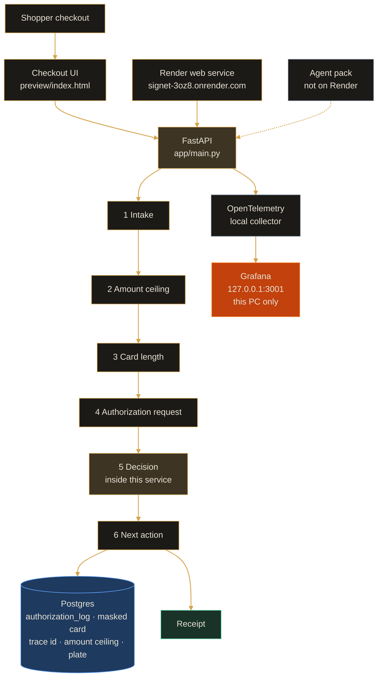

# Signet


**An e-commerce payment gateway, with the operations console beside the checkout.** The shopper pays in this service. The operator inspects the same payment and sets the amount ceiling. The full card number is never stored and never returned.

**Public service:** https://signet-3oz8.onrender.com  
**Local app:** http://127.0.0.1:8001/  
**Local Grafana (this PC only):** http://127.0.0.1:3001  
**API docs:** http://127.0.0.1:8001/docs · contract in [`openapi.yaml`](openapi.yaml)

The decision runs inside this service. It does not call out to finish the authorization.

Hub on the local app: **Checkout · Inspector · Log · API · Grafana**. Grafana and the agent pack stay on this PC. They are not part of the public Render service.

## Mission

**Signet — one checkout, one decision, one receipt.**  
A shopper needs a clear stop, a sentence, and a next action. An operator needs the same payment, without a second product and without the full card number.

- Six steps run in this service: Intake, amount ceiling, card length, authorization request, decision, next action.
- A completed payment opens a receipt: amount, masked card, trace id, and time.
- Ops uses the same window. The tabs are Inspector, Log, API, and Grafana.
- The full card number is not stored, not returned, and not written to logs or telemetry.

The stack stays behind that screen. That is what this gateway is for.

## Table of contents

- [Mission](#mission)
- [Problem](#problem)
- [Status](#status)
- [Recent updates](#recent-updates)
- [Configuration](#configuration)
- [Prerequisites](#prerequisites)
- [Quick start](#quick-start)
- [Architecture](#architecture)
- [Decisions and trade-offs](#decisions-and-trade-offs)
- [Project structure](#project-structure)
- [Screenshots](#screenshots)
- [Evaluation criteria](#evaluation-criteria)
- [Cloud deployment](#cloud-deployment)
- [Troubleshooting](#troubleshooting)
- [License](#license)

---

## Problem

A shopper enters an amount and a card number and must see which of the six steps stopped, the sentence, and the next action. An operator uses the same theme to inspect that payment and to set the amount ceiling. The full card number is never stored.

The app is one checkout. The first screen is the payment. Ops replaces that screen in the same window. One tab is open at a time. There is no tab row on the customer screen. There is no Rule tab and no CSV upload.

The amount must be greater than 0 and at most the stored ceiling. The default ceiling is 500.00 USD. The card number must be 13 to 19 digits. CVC is collected on the form and is not sent, stored, logged, or printed.

1. **Intake** takes the amount and the card number.
2. **Amount ceiling** stops a payment at or below 0, or above the stored ceiling.
3. **Card length** stops a number outside 13 to 19 digits.
4. **Authorization request** continues only when the earlier checks passed.
5. **Decision** runs inside this service. One designated card completes. One designated card stops on the stored decline plate. Every other valid card receives the stored institution sentence, or the sentence that there is no decline rule.
6. **Next action** is completed, or the edit the decision allows.

`POST /authorizations` returns HTTP 200. The decision status is the `http_status` field in the body. The card number is not a response field. A successful payment can be opened as a receipt. Print and Close are the only receipt actions. Close does not discard the statement. End, beside AC, does.

Statement of the problem and the exclusions: [`SPEC.md`](SPEC.md), [`docs/packets/01-problem-statement.md`](docs/packets/01-problem-statement.md).

### Stored records

Postgres holds the authorization log, a masked card, a trace id, the amount ceiling, and the one decline plate. The full card number is not a column.

| Record | Detail |
|--------|--------|
| `authorization_log` | `stop_step`, `sentence`, `http_status`, `log_field`, `retry`, `amount`, `created_at`, `masked_card`, `trace_id` |
| `plate` | One row. Name, shopper sentence, HTTP status, log field, and retry. No card number |
| `institution_rule` | One row. The amount ceiling is `amount_limit`. Default 500. Also the sentence used when the card is neither the approval card nor the decline plate |
| `rule_document` | Copies of that institution row for the API. The Ops console does not edit them and does not upload a file |

The Log tab reads `GET /logs`. That response has no card column. The receipt reads `GET /authorizations/latest`, which returns the masked card and the trace id.

Gate note: [`docs/packets/05-data-persistence.md`](docs/packets/05-data-persistence.md).

### Operations console

| Tab | What it shows |
| --- | --- |
| Inspector | The latest statement when that payment's HTTP status is 200, otherwise an empty statement. Payment detail shows the recorded sentence, HTTP status, log field, and retry. The amount ceiling sits at the bottom. Set limit writes the ceiling used by the amount step. This tab does not edit the decline plate or the institution sentence. |
| Log | Authorization rows from `GET /logs`. No card column. |
| API | Live routes and `/docs`. The contract file is [`openapi.yaml`](openapi.yaml). |
| Grafana | Local only, at http://127.0.0.1:3001. It is not part of the public service. |

[↑ Contents](#table-of-contents)

---

## Status

**The public service is the Render web app.** Local Compose adds Postgres and the telemetry stack on this PC. Grafana is not deployed. The agent pack is not deployed. See [Evaluation criteria](#evaluation-criteria) and [Cloud deployment](#cloud-deployment).

**Public service:** https://signet-3oz8.onrender.com  
`main` auto-deploys the Render **development** service. **Production** is a manual deploy in the Render dashboard.

### Paths (read this first)

Commands below assume you are in the **repository root** after cloning.

| | |
|--|--|
| **Your machine** | Whatever path you cloned into |
| **Example used in this README** | `E:\IT_SPACES\AI\Projects\aidt\signet` (author's Windows layout — **not required**) |

Replace the example `cd` with your own clone path. Relative paths such as `app/`, `preview/`, and `docker compose -f docker-compose.yaml` are the same everywhere.

[↑ Contents](#table-of-contents)

---

## Recent updates

**The service described on this page is the service in the repository.** There is no separate changelog file.

- Checkout, the six steps, Postgres, and the receipt are one FastAPI app. The decision runs in `app/main.py`.
- Ops tabs are Inspector, Log, API, and Grafana. There is no Rule tab and no CSV upload.
- Grafana stays at http://127.0.0.1:3001 on this PC. The agent pack stays in this repo and is not deployed to Render.
- `main` auto-deploys the Render development service. Production is started by a person in the Render dashboard.

[↑ Contents](#table-of-contents)

---

## Configuration

| Role | Where it runs | Variables |
|------|----------------|-----------|
| App | Local Compose and the Render web service | `DATABASE_URL`. Local default is Postgres on the host port **5433**. On Render, set `DATABASE_URL` to the Render Postgres connection string. |
| Listen port | Container | `PORT`. Local Compose publishes **8001**. The image uses `${PORT:-8001}`. |
| Traces, metrics, logs | Local Compose only | `OTEL_EXPORTER_OTLP_ENDPOINT` (Compose sets `http://otel-collector:4318`). |
| Grafana | This PC only | User and password are the Grafana environment values in [`docker-compose.yaml`](docker-compose.yaml). Anonymous viewing is enabled as Viewer. **Not** set on Render. |
| Agent pack | This PC only | No Render environment. It reads `http://127.0.0.1:8001/plates`. |

This repo does not ship a `.env.example`. Local values live in [`docker-compose.yaml`](docker-compose.yaml). Public database settings live in the Render dashboard.

```powershell
# Example path (replace with your clone root):
cd E:\IT_SPACES\AI\Projects\aidt\signet
docker compose -f docker-compose.yaml up -d --build
```

[↑ Contents](#table-of-contents)

---

## Prerequisites

- [Docker Desktop](https://www.docker.com/)
- Python 3.12+ when you run `pytest` on the host (the image is `python:3.12-slim`)

No model key. The decision does not call an LLM.

[↑ Contents](#table-of-contents)

---

## Quick start

**Recommended:** app, Postgres, and the local telemetry stack via Compose.

```powershell
# Example path (replace with your clone root):
cd E:\IT_SPACES\AI\Projects\aidt\signet
docker compose -f docker-compose.yaml up -d --build
docker compose -f docker-compose.yaml ps
# App http://127.0.0.1:8001/ · Grafana http://127.0.0.1:3001 · Postgres host :5433
```

Open http://127.0.0.1:8001/

| Service | Host port | Notes |
|---------|-----------|--------|
| `app` | **8001** | Checkout, Ops, and the API. Image from [`Dockerfile`](Dockerfile) |
| `postgres` | **5433** | Postgres 16. Data bind-mount is local and is not part of the Git history |
| `grafana` | **3001** | This PC only. Dashboards `signetpay` and `signettrace` |
| `otel-collector` | none | OpenTelemetry collector. App exports to it inside Compose |
| `prometheus` | none | Metrics for the Grafana boards |
| `loki` | none | Log lines. The line has a trace id and no card number |
| `tempo` | none | Traces for the same request |

### Tests on this machine

Integration tests expect Postgres from Compose (host port 5433). The default `DATABASE_URL` in `app/main.py` points at that port.

```powershell
# Example path (replace with your clone root):
cd E:\IT_SPACES\AI\Projects\aidt\signet
docker compose -f docker-compose.yaml up -d postgres
pytest
```

| File | What it checks |
|------|----------------|
| [`tests/test_unit.py`](tests/test_unit.py) | `digits` keeps numbers only |
| [`tests/test_integration.py`](tests/test_integration.py) | One approval and one decline. The response text does not contain the card number. The newest log row is read back |
| [`tests/test_screen.py`](tests/test_screen.py) | `preview/index.html` contains the checkout and Ops labels used by those paths |

Gate note: [`docs/packets/06-automated-testing.md`](docs/packets/06-automated-testing.md).

There is no GitHub Actions workflow in this repo. Tests run on the machine that has Postgres.

### Local agent pack

The pack reads the local decline plate. It does not deploy itself, and it does not deploy Grafana.

```powershell
python agent-hooks/block_pan.py SOME_FILE
python custom-agent/agent.py
python mcp-server/server.py --once
```

`custom-agent/agent.py` and `mcp-server/server.py` call `GET http://127.0.0.1:8001/plates` on this PC. If the body contains a full card number, the custom agent prints nothing and stops. There is no POST. Permissions: [`docs/permissions.md`](docs/permissions.md) and [`AGENTS.md`](AGENTS.md).

[↑ Contents](#table-of-contents)

---

## Architecture


**Live path:** Shopper checkout → FastAPI six steps (Intake, amount ceiling, card length, authorization request, decision, next action) → Postgres (authorization log, masked card, trace id, amount ceiling, decline plate) → receipt. OpenTelemetry and Grafana stay on this PC at http://127.0.0.1:3001. The agent pack stays off Render.

Technical graph (same system, code-oriented):



**Request path (short):** amount and card → checkout UI → `POST /authorizations` → ceiling, then length, then the in-service decision → log row (masked card, trace id) → receipt. Local requests also export through the OpenTelemetry collector to Grafana. The public Render service is the web app and Render Postgres. Grafana and the agent pack are not on that service.

### Tech stack

| Piece | Role |
| --- | --- |
| FastAPI | Checkout, the six-step pipeline, and the operations routes. `app/main.py` |
| Preview | Shopper screen and Ops, one dark theme. `preview/index.html` |
| Postgres 16 | Authorization log, masked card, trace id, amount ceiling, decline plate |
| OpenTelemetry | Spans, metrics, and log export from `app/telemetry.py` |
| Prometheus, Loki, Tempo | Local backends for the Grafana boards |
| Grafana 11 | Local dashboards only. http://127.0.0.1:3001 |
| Docker | App image plus the Compose stack in `docker-compose.yaml` |

### API surface

Contract: [`openapi.yaml`](openapi.yaml). Interactive docs: `/docs` on the running app.

| Method | Path | Role |
|--------|------|------|
| `GET` | `/` | Checkout and Ops UI |
| `POST` | `/authorizations` | Run the six steps. Body: `amount`, `card`. Response fields do not include the card number |
| `GET` | `/authorizations/latest` | Newest receipt: status, amount, masked card, trace id, time, sentence |
| `GET` | `/logs` | Authorization rows. No card column |
| `GET` | `/plates` | Read the one decline plate |
| `POST` | `/plates` | Replace that plate. The agent pack does not call this |
| `GET` | `/rules` | Read the institution row, including `amount_limit` |
| `PUT` | `/rules/limit` | Set the amount ceiling used by the amount step |
| `GET` | `/ops/board` | Request rate, latency, and the audit stream for the last 15 minutes |
| `GET` | `/docs` | Swagger UI |

`/rules` and `/rules/documents` exist on the API. The Ops console has no Rule tab and no CSV upload. Inspector writes the ceiling only.

Gate notes: [`docs/packets/03-api-contract.md`](docs/packets/03-api-contract.md), [`docs/packets/04-backend.md`](docs/packets/04-backend.md).

[↑ Contents](#table-of-contents)

---

## Decisions and trade-offs

- **Decision inside this service.** Ceiling, length, the approval card, the decline plate, and the institution sentence are applied in `app/main.py`. Trade-off: there is no external authorizer to swap in. The behavior is the code and the stored plate.
- **One HTTP 200 from `POST /authorizations`.** The shopper-facing outcome is `http_status` in the JSON body, plus `sentence`, `log_field`, and `retry`. Trade-off: a client that only looks at the transport status will treat a decline as success unless it reads the body.
- **Masked card on the log, no full number.** `authorization_log.masked_card` is stored. The plate table has no card column. `GET /logs` does not return a card. Trade-off: a receipt can show a mask; it cannot show or recover the full number.
- **CVC stays on the form.** The field is masked in the browser. It is not sent, stored, logged, or printed. Trade-off: the API cannot echo it, because it never receives it.
- **Grafana on this PC only.** Compose runs the collector, Prometheus, Loki, Tempo, and Grafana. Render runs the web service and Render Postgres. Trade-off: the public URL has no metrics UI. Operators use http://127.0.0.1:3001.
- **Agent pack off Render.** Skill, subagent note, MCP server, digit-run hook, and the custom agent stay in the repo and talk to the local app. Trade-off: the public site does not expose those tools.
- **Development follows `main`. Production does not.** A push to `main` auto-deploys the Render development service. Production is a manual deploy in the Render dashboard. Trade-off: two Render actions, so a development deploy is not a production deploy.
- **No second public UI.** There is no separate hosted prototype. The same `preview/index.html` is what Compose and Render serve.

### Security notes

The review memo is [`docs/security-review.md`](docs/security-review.md). It records a point-in-time check on the local app: the full card number was not in `GET /plates`, not in the authorization response, not in `authorization_log` or `plate` as a full number, and not in the app log line or local Loki. The hook `agent-hooks/block_pan.py` blocks a file that contains 13 or more consecutive digits.

Limits recorded in that memo, not extra controls: Semgrep was not installed, Grafana alert rules were not added, and the public app was not called for that review. The hook does not treat spaces or dashes as a digit run. AWS is not used.

[↑ Contents](#table-of-contents)

---

## Project structure

```text
app/                  # FastAPI app, six steps, Postgres access, OpenTelemetry
  main.py             # Routes, tables, decision
  telemetry.py        # OTLP export and the in-process request board
preview/              # Checkout and Ops UI (index.html) plus Swagger CSS
tests/                # Unit, integration, and screen tests
observability/        # Collector, Prometheus, Loki, Tempo, Grafana provisioning
agent-hooks/          # block_pan.py — blocks a long digit run in a file
custom-agent/         # Reads GET /plates on this PC
mcp-server/           # Local MCP read of the same plate
agent-capabilities/   # Local skill and authorization-reviewer note
docs/                 # Gate packets, security review, hero and architecture images
  packets/            # 01 problem through 11 security review
  security-review.md
  signet-gateway.jpg
  signet-architecture.jpg
openapi.yaml          # API contract
Dockerfile            # python:3.12-slim, uvicorn, PORT
docker-compose.yaml   # app, Postgres, local telemetry
requirements.txt
SPEC.md               # Problem, screens, exclusions
AGENTS.md             # What the local agent pack may do
```

[`samples/`](samples) is present for local files the app can read. It is not an Ops screen, and this README does not ask anyone to upload a CSV.

[↑ Contents](#table-of-contents)

---

## Screenshots

This repo ships two graphics: the gateway hero and the architecture diagram. It does not ship a gallery of Grafana or Render screenshots. The live pages are the public service and, on this PC, Compose.

### Public checkout

https://signet-3oz8.onrender.com

The Render service serves the same checkout and Ops UI as the local app. Grafana is not on that host. The agent pack is not on that host.


### Checkout and receipt

The hero is the shopper path: the six-step rail, amount, masked payment method, Pay, and a receipt with amount, masked card, and trace id. Tabs along the bottom are Inspector, Log, API, and Grafana.

Local: http://127.0.0.1:8001/

UI note: [`docs/packets/02-ui-prototyping.md`](docs/packets/02-ui-prototyping.md).

### Monitoring

Grafana is local only.

| Board | URL |
|-------|-----|
| Signet | http://127.0.0.1:3001/d/signetpay/signet |
| Signet trace | http://127.0.0.1:3001/d/signettrace/signet-trace |

Panels on the Signet board: request count, HTTP error rate, average latency, request rate by status, P95 and P99, and the payment and decline log with trace ids. Success is green. An HTTP decline is red. The same log line is in local Loki. The card number is not an attribute.

No screenshot file of those boards is stored in this repo. Open the URLs above after Compose is up. They are not on https://signet-3oz8.onrender.com.

Gate note: [`docs/packets/09-observability.md`](docs/packets/09-observability.md).

### Docker Compose

`docker compose -f docker-compose.yaml up -d --build` starts the app on **8001**, Postgres on **5433**, and Grafana on **3001**, plus the collector, Prometheus, Loki, and Tempo without published host ports.

The picture of that path is [`docs/signet-architecture.jpg`](docs/signet-architecture.jpg). Container note: [`docs/packets/07-containerization.md`](docs/packets/07-containerization.md).

### Ops

Ops is one control on the checkout. It opens in the same window. Tabs:

| Tab | On the screen |
|-----|----------------|
| Inspector | Statement, payment detail, amount ceiling at the bottom |
| Log | Authorization rows, no card column |
| API | Live routes and `/docs` |
| Grafana | Embedded local boards when Grafana is on this PC |

There is no password gate in this app, and there is no Rule tab.

### Not a second public app

There is no second hosted UI, no public Grafana, and no public agent endpoint. Peer review of the running product uses https://signet-3oz8.onrender.com. Metrics and the agent pack stay on the machine that runs Compose.

[↑ Contents](#table-of-contents)

---

## Evaluation criteria

Maps this repo to the eleven gates under [`docs/packets/`](docs/packets). A reviewer can follow the **Evidence** links. Rows after the eleven gates are the reference checklist items that this gateway does not implement as named there, with the Signet fact in their place.

| # | Criterion | Evidence in this repo |
|---|-----------|------------------------|
| 1 | **Problem statement** | [`SPEC.md`](SPEC.md), [`docs/packets/01-problem-statement.md`](docs/packets/01-problem-statement.md). Shopper sees six steps and a sentence. Operator sees Ops. Full card number is not stored. |
| 2 | **UI** | [`preview/index.html`](preview/index.html), [`docs/packets/02-ui-prototyping.md`](docs/packets/02-ui-prototyping.md). Checkout and Ops share one window. Receipt is not a modal. |
| 3 | **API contract** | [`openapi.yaml`](openapi.yaml), [`docs/packets/03-api-contract.md`](docs/packets/03-api-contract.md). `POST /authorizations`, `GET /plates`, `GET /authorizations/latest`, `GET /logs`, `PUT /rules/limit`. |
| 4 | **Backend** | [`app/main.py`](app/main.py), [`docs/packets/04-backend.md`](docs/packets/04-backend.md). Ceiling, length, approval, decline plate, and institution sentence. Decision runs in this file. |
| 5 | **Data persistence** | Postgres 16 on host port **5433**. Tables `authorization_log` (masked card, trace id), `plate`, `institution_rule` (`amount_limit`). [`docs/packets/05-data-persistence.md`](docs/packets/05-data-persistence.md). |
| 6 | **Automated testing** | [`tests/`](tests). [`docs/packets/06-automated-testing.md`](docs/packets/06-automated-testing.md). Unit, one approval, one decline, and the preview labels. |
| 7 | **Containerization** | [`Dockerfile`](Dockerfile), [`docker-compose.yaml`](docker-compose.yaml). [`docs/packets/07-containerization.md`](docs/packets/07-containerization.md). |
| 8 | **Deployment** | https://signet-3oz8.onrender.com. `main` auto-deploys **development**. **Production** is a manual deploy in the Render dashboard. [`docs/packets/08-deployment.md`](docs/packets/08-deployment.md). |
| 9 | **Observability** | [`observability/`](observability), [`app/telemetry.py`](app/telemetry.py). Grafana http://127.0.0.1:3001 only. Not on Render. [`docs/packets/09-observability.md`](docs/packets/09-observability.md). |
| 10 | **Agentic extension** | [`AGENTS.md`](AGENTS.md), [`agent-hooks/block_pan.py`](agent-hooks/block_pan.py), [`custom-agent/`](custom-agent), [`mcp-server/`](mcp-server), [`agent-capabilities/`](agent-capabilities). Not on Render. [`docs/packets/10-agentic-extension.md`](docs/packets/10-agentic-extension.md). |
| 11 | **Security review** | [`docs/security-review.md`](docs/security-review.md), [`docs/packets/11-security-review.md`](docs/packets/11-security-review.md). Full card number absent from storage, the response, logs, and telemetry in that check. |
| — | **Reproducibility** | [Quick start](#quick-start), [`requirements.txt`](requirements.txt), [`Dockerfile`](Dockerfile), [`docker-compose.yaml`](docker-compose.yaml). No `.env.example`. |
| — | **Ingestion pipeline** | Not a separate product. `init_db()` creates tables on startup in [`app/main.py`](app/main.py). No workflow engine in this repo. |
| — | **Retrieval evaluation** | Not in this repo. There is no search index and no offline retrieval score. Payment checks are [`tests/`](tests). |
| — | **LLM evaluation** | Not in this repo. The decision does not call an LLM. |
| — | **Hybrid search** | Not in this repo. |
| — | **Re-ranking** | Not in this repo. |
| — | **Query rewriting** | Not in this repo. |
| — | **Interface** | Same evidence as row 2. Public: https://signet-3oz8.onrender.com. Local: http://127.0.0.1:8001/ |
| — | **Monitoring** | Same evidence as row 9. Boards `signetpay` and `signettrace`. Public Grafana is not deployed. |
| — | **Containerization (compose)** | Same evidence as row 7. `docker compose -f docker-compose.yaml up -d --build` |
| — | **Cloud deployment** | Same evidence as row 8. Render web service on Docker, branch `main`, plus Render Postgres. No Blueprint file in this repo. |
| — | **Agent / tools** | Same evidence as row 10. Local read of `GET /plates`. No POST from the pack. |
| — | **Safety** | Same evidence as row 11, plus [`agent-hooks/block_pan.py`](agent-hooks/block_pan.py). |

### Quick verification commands

```powershell
# Example path (replace with your clone root):
cd E:\IT_SPACES\AI\Projects\aidt\signet
docker compose -f docker-compose.yaml up -d --build
# http://127.0.0.1:8001/  ·  http://127.0.0.1:3001
pytest
python agent-hooks/block_pan.py README.md
python custom-agent/agent.py
python mcp-server/server.py --once
```

`pytest` needs Postgres on host port 5433. The agent commands need the local app. They do not target the public URL.

[↑ Contents](#table-of-contents)

---

## Cloud deployment

### Render

Primary public face: https://signet-3oz8.onrender.com

This repo has no `render.yaml`. The service is a Render **web service** built from [`Dockerfile`](Dockerfile), branch `main`, plus **Render Postgres**.

1. The development service tracks `main`. A push to `main` auto-deploys **development**.
2. **Production** is a manual deploy in the Render dashboard. It does not follow that push by itself.
3. On the web service, set `DATABASE_URL` to the Render Postgres connection string. Do not point it at the laptop's port 5433.
4. The image listens on Render's `PORT`:

```text
uvicorn app.main:app --host 0.0.0.0 --port ${PORT:-8001}
```

5. Do not add Grafana, the OpenTelemetry collector, Prometheus, Loki, Tempo, or the agent pack to that service.
6. Smoke the public URL at `/` after the deploy is live. `/docs` is the API UI on that same host.

Deploy note: [`docs/packets/08-deployment.md`](docs/packets/08-deployment.md).

### What stays on this PC

| Piece | Where |
|-------|--------|
| Grafana http://127.0.0.1:3001 | Compose on this PC. Not a Render service |
| Prometheus, Loki, Tempo, collector | Compose on this PC |
| Agent pack (`AGENTS.md`, `agent-hooks`, `custom-agent`, `mcp-server`) | This repo, this PC. Not deployed |
| Postgres host port 5433 | Local Compose only. Render uses its own Postgres |

There is no second public prototype and no hosted metrics site.

### Postgres

| Place | Database |
|-------|----------|
| This PC | Compose Postgres 16, host port **5433**, database `signet`. The URL is `DATABASE_URL` in [`docker-compose.yaml`](docker-compose.yaml). |
| Public service | Render Postgres. The web service `DATABASE_URL` is that connection string. |

Local data is a bind mount on this machine. It is not committed. Restarting the app keeps the log, the plate, and the ceiling. The public database is separate from that volume.

### Rollback

Keep the previous deploy. In the Render service, open **Events** or **Deploys**, choose the earlier successful deploy, and roll back. The previous image serves again. Do not delete that older deploy until the new one is confirmed.

Rolling back the web service does not change Grafana, because Grafana was not deployed. It does not roll back the local Postgres volume.

[↑ Contents](#table-of-contents)

---

## Troubleshooting

1. **The public site has no Grafana.** That is expected. Open http://127.0.0.1:3001 on the machine running Compose. Port **3000** is not this project's Grafana. Signet uses **3001**.
2. **Port already in use.** This stack needs **8001** (app), **5433** (Postgres), and **3001** (Grafana). Stop the other process or the other Compose project that holds the port, then start again:

```powershell
# Example path (replace with your clone root):
cd E:\IT_SPACES\AI\Projects\aidt\signet
docker compose -f docker-compose.yaml up -d --build
docker compose -f docker-compose.yaml ps
```

3. **`pytest` cannot connect.** Start Postgres first. The tests use host port 5433. The app container uses the hostname `postgres`, not `127.0.0.1`.
4. **Agent commands fail.** `custom-agent/agent.py` and `mcp-server/server.py` read http://127.0.0.1:8001/plates. The local app must be up. They are not aimed at the Render URL.
5. **A file is blocked by the hook.** `agent-hooks/block_pan.py` exits with a block when it sees 13 or more consecutive digits. That is the intended check. Do not commit a full card number to get past it.
6. **Development changed and production did not.** `main` auto-deploys development only. Production is a manual deploy in the Render dashboard. Use [Rollback](#rollback) if the new image should not stay.

This repo does not include a separate Docker troubleshooting guide.

[↑ Contents](#table-of-contents)

---

## License

This repository does not include a `LICENSE` file.

[↑ Contents](#table-of-contents)
