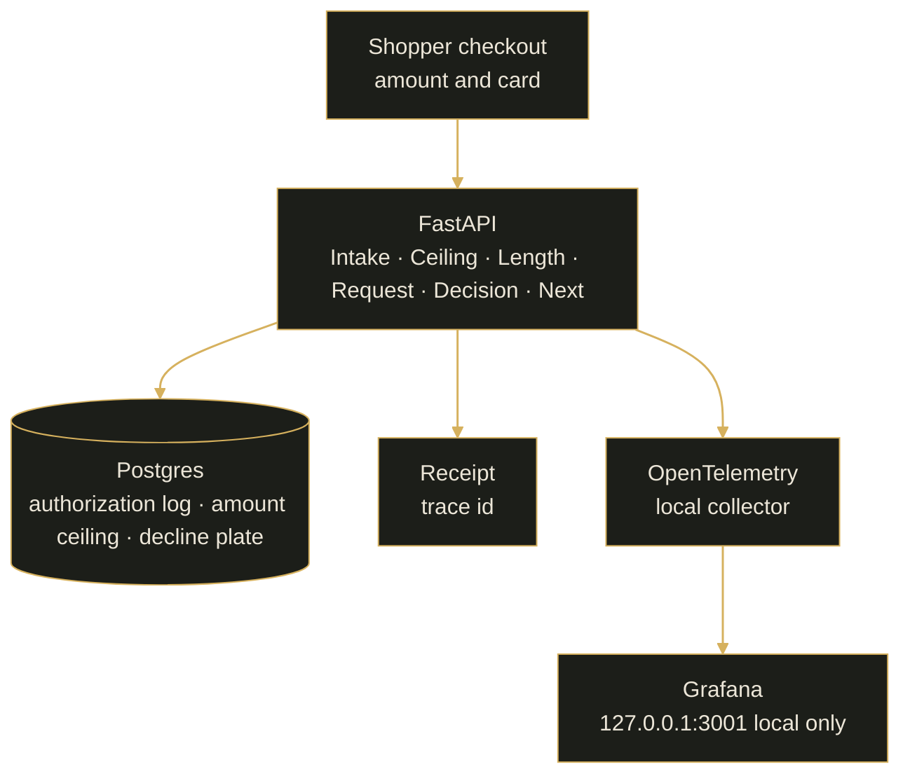

# Signet


**An e-commerce payment gateway, with the operations console beside it.** A shopper enters an amount and a card number. The service walks that payment through six steps and, on success, issues a receipt with a trace id. The full card number is never stored.

**Public service:** https://signet-3oz8.onrender.com  
**Local app:** http://127.0.0.1:8001/  
**Grafana (this PC only):** http://127.0.0.1:3001

Ops on the checkout: **Inspector · Log · API · Grafana**. Grafana is not on the public service.

## Mission

**A payment has to stop in a definite place.** The shopper sees which step stopped, the sentence, and the next action. The operator inspects the same payment from the console beside the checkout.

- The full card number is never stored and never returned.
- The decision runs inside this service.
- A completed payment leaves a receipt with a trace id.

## Table of contents

- [Mission](#mission)
- [Problem](#problem)
- [Status](#status)
- [Recent updates](#recent-updates)
- [Configuration](#configuration)
- [Prerequisites](#prerequisites)
- [Quick start](#quick-start)
- [Architecture](#architecture)
- [Decisions and trade-offs](#decisions-and-trade-offs)
- [Project structure](#project-structure)
- [Screenshots](#screenshots)
- [Cloud deployment](#cloud-deployment)
- [Troubleshooting](#troubleshooting)
- [License](#license)
- [Evaluation criteria](#evaluation-criteria)

---

## Problem

A shopper enters an amount and a card number. Signet runs that payment through six steps: Intake, amount ceiling, card length, authorization request, decision, and next action. The shopper sees the sentence for the step that stopped, and the next action, on the same screen.

The amount must be greater than 0 and at most the stored ceiling. The default ceiling is 500.00 USD. The card number must be 13 to 19 digits. Success issues a receipt with a trace id. The full card number is never stored.

The decision runs inside this service.

### Knowledge base

Signet has no document knowledge base. This heading is kept because the reference page has one. The pipeline reads two stored records in Postgres: the amount ceiling, and the one decline plate. There is no Rule tab and no CSV upload on the checkout.

[↑ Contents](#table-of-contents)

---

## Status

**Public service:** https://signet-3oz8.onrender.com  
**Local app:** http://127.0.0.1:8001/  
**Grafana:** http://127.0.0.1:3001 on this PC only. It is not deployed with the public service.

`main` auto-deploys the Render development service. Production is a manual deploy in the Render dashboard.

### Paths (read this first)

Commands below assume the repository root after cloning.

| | |
| --- | --- |
| App | http://127.0.0.1:8001/ |
| Postgres | host port 5433 |
| Grafana | http://127.0.0.1:3001 (this PC only) |

Local Compose bind-mounts this checkout. On this machine the working root is `E:\IT_SPACES\AI\Projects\aidt\signet`.

[↑ Contents](#table-of-contents)

---

## Recent updates

Shipped behavior of the service:

- Inspector stores the amount ceiling. The default is 500.00 USD. There is no screen for editing institution sentences.
- A completed payment can be opened as a receipt. The receipt shows the amount, a masked card, the trace id, and the time.
- The authorization log stores a masked card and a trace id. It does not store the full card number.

[↑ Contents](#table-of-contents)

---

## Configuration

| Role | Where it is set | Variables |
| --- | --- | --- |
| App database | Compose locally; Render dashboard for the public service | `DATABASE_URL` |
| Listen port | Image command | `PORT` (default `8001`) |
| Traces and metrics | Compose, app service | `OTEL_EXPORTER_OTLP_ENDPOINT` (local collector) |
| Grafana | This PC only | http://127.0.0.1:3001 — not set on the public service |

Set `DATABASE_URL` on Render to the Render Postgres connection string. Grafana and the local agent pack are not part of that service.

[↑ Contents](#table-of-contents)

---

## Prerequisites

- [Docker Desktop](https://www.docker.com/)
- Python 3.12 (the image is `python:3.12-slim`)

[↑ Contents](#table-of-contents)

---

## Quick start

```bash
docker compose -f docker-compose.yaml up -d --build
```

Open http://127.0.0.1:8001/

Postgres is on host port 5433. The app listens on 8001. Grafana, on this PC only, is http://127.0.0.1:3001.

| Service | Port | Notes |
| --- | --- | --- |
| App | **8001** | Checkout and operations console |
| Postgres | **5433** | Host port mapped to 5432 in the container |
| Grafana | **3001** | This PC only. Not on the public service |

### Dev alternative (host Python)

The container starts `uvicorn app.main:app`. This repository does not document a separate host-Python quick start. Use Compose.

### Agent tools

These readers stay on this PC. They are not deployed to Render.

- `python custom-agent/agent.py` reads `GET http://127.0.0.1:8001/plates` and prints the plate fields. It does not POST.
- `python mcp-server/server.py --once` reads the same local plate route. It does not POST.
- `agent-hooks/block_pan.py` blocks a file that contains a run of 13 digits.

There is no refund-agent tool, and no order-lookup tool, in this repository.

[↑ Contents](#table-of-contents)

---

## Architecture


**Live path:** shopper checkout → FastAPI six-step pipeline → Postgres (authorization log, amount ceiling, decline plate) → receipt with a trace id. OpenTelemetry stays on this PC and feeds Grafana at http://127.0.0.1:3001. Grafana is not on the public service.



**Request path (short):** amount and card number → Intake → amount ceiling → card length → authorization request → decision inside this service → next action. Success writes the authorization log and opens a receipt with a trace id. The full card number is not stored.

[↑ Contents](#table-of-contents)

---

## Decisions and trade-offs

- **Decision inside this service.** Authorization request and decision run here. The service does not call out for the decision. Trade-off: the sentence comes from this service and the stored decline plate, not from an outside authorization host.
- **Full card number is never stored.** The log keeps a masked card and a trace id. Trade-off: a later screen cannot show the original number. The receipt shows the mask and the trace id.
- **Grafana stays on this PC.** Prometheus, Tempo, Loki, and the OpenTelemetry collector run in local Compose. Trade-off: the public service has no Grafana URL. Rate and latency are on http://127.0.0.1:3001.
- **`main` auto-deploys development. Production is manual.** A push to `main` updates the Render development service. Production is a manual deploy in the Render dashboard. Trade-off: production does not move on every push.
- **One decline plate. No Rule tab.** One stored plate supplies the decline sentence. Inspector edits the amount ceiling only. Trade-off: there is no screen, and no CSV upload, for institution sentences.
- **Ops is four tabs on the checkout.** Inspector, Log, API, and Grafana. Trade-off: there is no separate product site for operations.

[↑ Contents](#table-of-contents)

---

## Project structure

```text
app/                 # FastAPI pipeline, persistence, telemetry
preview/             # Checkout UI (index.html)
tests/               # Unit, integration, and screen tests
observability/       # OTel collector, Prometheus, Tempo, Grafana provisioning
agent-hooks/         # Local hook that blocks a 13-digit run in a file
custom-agent/        # Local read-only plate reader
mcp-server/          # Local read-only plate reader
docs/                # Packets, security review, page graphics
openapi.yaml         # API contract
Dockerfile           # Python 3.12 image
docker-compose.yaml  # App, Postgres, local observability
AGENTS.md            # Local agent pack limits
SPEC.md              # Problem, checkout, and ops
```

[↑ Contents](#table-of-contents)

---

## Screenshots

### Official Product (Render)

Public service: https://signet-3oz8.onrender.com

The graphic below is the gateway dashboard frame used on this page: pipeline rail, checkout, receipt, and the Inspector / Log / API / Grafana tabs.


### Hybrid retrieval (secondary — Streamlit)

No Signet equivalent. This repository has no retrieval index and no Streamlit app.

### Monitoring (Postgres → Grafana + feedback)

Grafana is local only, at http://127.0.0.1:3001. Dashboards are provisioned under `observability/grafana/`. No Grafana screenshot is stored in this repository. Grafana is not on the public service. There is no public thumbs-up feedback store.

### Docker Compose (Streamlit in container — local ops)

No Streamlit service. Local Compose is the app, Postgres, and the observability stack:

```bash
docker compose -f docker-compose.yaml up -d --build
```

There is no separate screenshot of the container UI. The gateway frame is [docs/signet-gateway.jpg](docs/signet-gateway.jpg).

### Ops (password-gated)

No password gate. Ops is a button on the checkout. The tabs are Inspector, Log, API, and Grafana.

| Tab | What it shows |
| --- | --- |
| Inspector | The latest statement, the payment detail, and the amount ceiling at the bottom. Set limit writes the ceiling used by the amount step. There is no screen for editing institution sentences. |
| Log | Authorization rows. No card column. |
| API | Live routes and `/docs`. |
| Grafana | Local only, at http://127.0.0.1:3001. It is not part of the public service. |

### Secondary prototype (Streamlit Cloud)

No Signet equivalent. There is one public service: https://signet-3oz8.onrender.com

[↑ Contents](#table-of-contents)

---

## Cloud deployment

### Official: Render

Public service: https://signet-3oz8.onrender.com

`main` auto-deploys the Render development service. Production is a manual deploy in the Render dashboard. The service is Docker, branch `main`, plus Render Postgres. Set `DATABASE_URL` to the Render Postgres connection string.

The image listens on Render's `PORT`:

```text
uvicorn app.main:app --host 0.0.0.0 --port ${PORT:-8001}
```

Grafana and the local agent pack are not deployed there.

To roll back, keep the previous deploy. In the Render service, open Events or Deploys, choose the earlier successful deploy, and roll back. Do not delete that older deploy until the new one is confirmed.

### Secondary prototype: Streamlit Community Cloud

No Signet equivalent. There is no Streamlit Cloud app.

### Neon setup

No Signet equivalent. The public database is Render Postgres, reached with `DATABASE_URL`. There is no Neon project in this repository.

[↑ Contents](#table-of-contents)

---

## Troubleshooting

If the local stack does not answer:

1. From the repository root, run `docker compose -f docker-compose.yaml up -d --build`.
2. Confirm the app on http://127.0.0.1:8001/ , Postgres on host port 5433, and Grafana on http://127.0.0.1:3001.
3. If `docker ps` does not return, restart Docker Desktop and run the Compose command again.

This repository has no `docs/DOCKER_TROUBLESHOOT.md`. Grafana on this project is port **3001** only. It is not deployed to Render.

[↑ Contents](#table-of-contents)

---

## License

This repository has no `LICENSE` file.

[↑ Contents](#table-of-contents)

---

## Evaluation criteria

Grader checklist for this repository. A row is **Yes** only where the file is in the tree. There is no GitHub Actions workflow, so this page has no build badge.

| Item | Where it lives | Done |
| --- | --- | --- |
| 1 Problem statement | [`SPEC.md`](SPEC.md), [`docs/packets/01-problem-statement.md`](docs/packets/01-problem-statement.md) | Yes |
| 2 UI prototyping | [`preview/index.html`](preview/index.html) | Yes |
| 3 API contract | [`openapi.yaml`](openapi.yaml) | Yes |
| 4 Backend | [`app/main.py`](app/main.py) | Yes |
| 5 Data persistence | Postgres in [`docker-compose.yaml`](docker-compose.yaml); authorization log, masked card, trace id, and amount ceiling in [`app/main.py`](app/main.py) | Yes |
| 6 Automated testing | [`tests/`](tests/) (`test_unit.py`, `test_integration.py`, `test_screen.py`) | Yes |
| 7 Containerization | [`Dockerfile`](Dockerfile), [`docker-compose.yaml`](docker-compose.yaml) | Yes |
| 8 Deployment | https://signet-3oz8.onrender.com — `main` auto-deploys the Render development service; production is a manual deploy in the Render dashboard. Notes in [`docs/packets/08-deployment.md`](docs/packets/08-deployment.md) | Yes |
| 9 Observability | Local Grafana, Prometheus, Tempo, and the OpenTelemetry collector under [`observability/`](observability/). Grafana is http://127.0.0.1:3001 and is not on Render | Yes |
| 10 Agentic extension | [`AGENTS.md`](AGENTS.md), [`agent-hooks/block_pan.py`](agent-hooks/block_pan.py), [`custom-agent/agent.py`](custom-agent/agent.py), [`mcp-server/server.py`](mcp-server/server.py). Not deployed to Render | Yes |
| 11 Security review | [`docs/security-review.md`](docs/security-review.md) | Yes |

### Quick verification commands

```bash
docker compose -f docker-compose.yaml up -d --build
python -m pytest
```

App: http://127.0.0.1:8001/ · Postgres host port 5433 · Grafana http://127.0.0.1:3001 (this PC only).

[↑ Contents](#table-of-contents)
